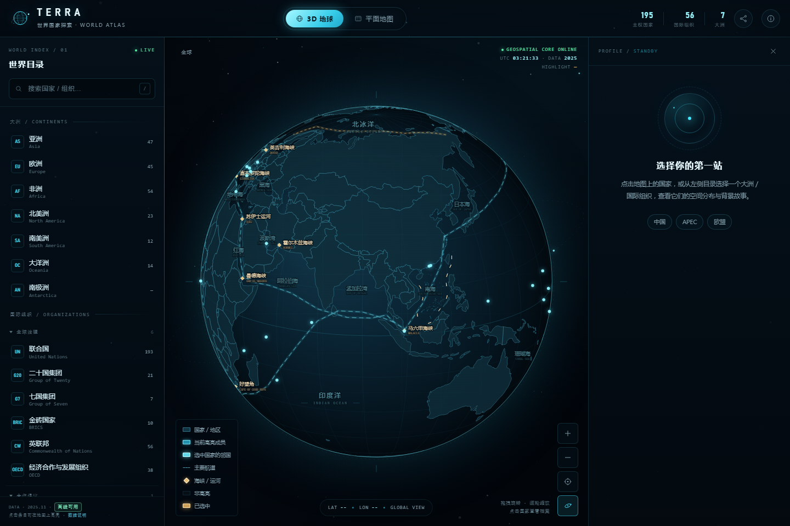
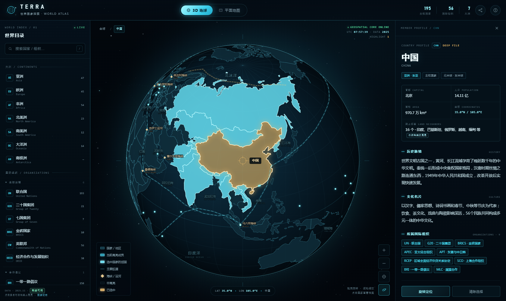
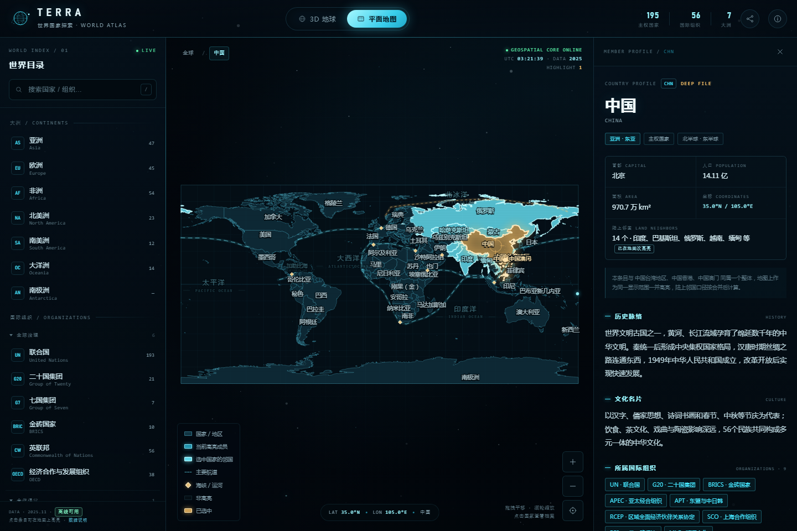

# TERRA · 世界国家探索

> 面向学生的世界国家探索地图 —— 可旋转的 3D 地球与平面地图，点击国家查看历史与文化，按大洲或国际组织一键高亮成员国。
> 纯静态单页应用，**双击 `index.html` 即可离线使用**，无需联网、无需安装、无需起服务器。

[](https://davin-96.github.io/terra-world-atlas/)
[](#本地使用)

---

## 这是什么

一个纯前端的地理探索工具，没有框架、没有后端、没有账号。整套国界数据与渲染引擎都在本地，**断网照常用**。

| 能力 | 说明 |
|---|---|
| **3D 地球** | D3 正交投影 + Canvas 球体光影，可拖拽旋转、滚轮缩放，不操作时自动缓慢旋转 |
| **平面地图** | 等距圆柱投影，110m 首屏秒开、随后自动升级 50m 精界，适合看清海域、航线与海峡咽喉 |
| **国家档案** | 195 个国家/地区，点击查看首都、人口、面积、坐标、陆上邻国、历史文化与所属组织 |
| **深档覆盖** | 70 个国家有完整历史与文化档案（G20 / APEC 成员已全部补全），其余为速览条目 |
| **组织高亮** | 56 个国际组织 + 7 大洲，一键高亮全部成员，并保留组织上下文面包屑 |
| **邻国高亮** | 选中国家即高亮其全部陆上邻国，与集团成员形成**三级层次**（焦点国 > 邻国 > 其余成员） |
| **同组并显** | 中国、中国台湾地区、中国香港、中国澳门作为**同一显示范围**一并高亮，陆上邻国口径合并计算 |
| **视图分享** | 视图状态写入 URL hash，顶部链环按钮一键复制链接，打开即还原同一视图 |

---

## 截图

### 首屏引导 · 离线可用



侧栏底部绿色「离线可用」徽章表示引擎与国界数据已全部从本地加载。

### 正交地球 · 中国档案



选中中国：焦点国金色、陆上邻国统一亮青、其余成员中青，三级层次一眼可辨。

### 同组地区一并显示



选中中国时，中国大陆、中国台湾地区、中国香港、中国澳门同时呈金色并各自标注名称；陆上邻国按合并口径计为 14 个。

---

## 本地使用

### 方式一：双击即用（推荐）

下载或克隆本仓库后，**直接双击 `index.html`**。

- 不联网、不装软件、不起服务器
- 侧栏底部显示绿色「**离线可用**」徽章，说明数据已从本地加载
- 若显示黄色「在线」徽章，说明 `vendor/` 目录不完整，已自动回退网络 —— 把整个文件夹拷全即可恢复离线

> 原理：国界 JSON 被包装成 `vendor/geo-data.js` 的全局变量，用 `<script>` 标签加载，绕开 `file://` 协议下的 CORS 限制。这是能否真正双击离线用的分水岭。

### 方式二：在线访问

<https://davin-96.github.io/terra-world-atlas/>

### 方式三：本地起服务器（需要改配置时）

```bash
# 任选其一，在项目根目录执行
python -m http.server 8000
npx serve .
```

然后访问 `http://localhost:8000`。

---

## 五步上手

1. **看引导** —— 首次打开自动弹出「选择你的第一站」，点「中国」「APEC」「欧盟」任一快捷入口先感受一下
2. **转地球** —— 在地图上拖拽旋转、滚轮缩放；不操作时自动缓慢旋转，点「暂停」可停
3. **查国家** —— 点地图上的国家，弹出档案卡：首都、人口、面积、坐标、陆上邻国、历史、文化、所属组织。选中后它呈金色，所有陆上邻国**统一高亮成亮青色**
4. **退出高亮** —— **再次点击同一个国家**即可退出（也可点海面空白处、按 `Esc` 或用档案里的「清除选择」）。退出时金色与亮青会以缓入缓出的转场平滑淡去
5. **看分布** —— 左侧目录点大洲或国际组织，地图一键高亮所有成员；从高亮成员里点某个国家，还能保留组织上下文（面包屑显示「全球 / APEC / 中国」）

---

## 操作速查

| 操作 | 方法 |
|---|---|
| 旋转地球 | 在地图上拖拽 |
| 平移平面地图 | 在地图上拖拽 |
| 缩放 | 滚轮 / 右下角 `+` `−` 按钮 / 双击 |
| 重置视图 | 右下角准星按钮 |
| 打开档案 | 点击国家 / 发光小圆点 |
| 关闭档案 | 右上角 `×` 或 `Esc` |
| 清除高亮 | 再次点击同一个国家 / 点海面空白处 / `Esc` / 档案里「清除选择」 |
| 快速搜索 | 按 `/` 聚焦搜索框，支持中文名/英文名/缩写（法国 / France / APEC） |
| 分享当前视图 | 顶部链环图标 |

### 视图分享

地址栏 URL 会实时记录当前视图：

```
#mode=flat&rot=-103,-18&org=apec&sel=CHN
```

包含模式、旋转角度、选中的组织/大洲/国家。点顶部链环按钮复制完整链接，别人打开即还原到同一视图。

---

## 目录结构

```
terra-world-atlas/
├─ index.html              页面结构（模式按钮、分享按钮、引导、本地依赖引用）
├─ world-map.css           样式（离线徽章、响应式适配）
├─ world-map.js            主程序（离线加载、邻国规则与统一配色、点击退出、URL 状态、引导）
├─ world-data.js           业务数据（schemaVersion 2.0.0，深档 70 国）
├─ vendor/                 本地依赖，保证离线可用
│  ├─ d3.min.js
│  ├─ topojson-client.min.js
│  ├─ countries-110m.json
│  ├─ countries-50m.json
│  └─ geo-data.js          【关键】国界数据包装为全局变量，绕开 file:// CORS
├─ 预览图/                 README 与文档配图
└─ README.md               本文件
```

---

## 数据来源与口径

- **国界几何**：Natural Earth 1:110m / 1:50m，经 [world-atlas](https://github.com/topojson/world-atlas) 转换为 TopoJSON
- **国家基础信息**：[world-countries](https://github.com/mledoze/countries) 与公开百科资料，中文译名参考 i18n-iso-countries
- **数据版本**：`world-data.js` schemaVersion **2.0.0**；国际组织成员名单按 2025 年公开资料整理，成员资格会随国际形势变化，重要判断请以官方发布为准
- **南海诸岛及九段线未在本图绘制**：所采用的 Natural Earth 公开数据集未包含相关要素，属国际公开数据的通行处理口径，并非遗漏或删改。正式用途请以官方发布的标准地图为准
- **地图为示意用途，不构成领土或边界主张**；争议地区在档案中以文字标注。人口、面积为约数，用于教学速览，不作为统计引用
- 中国台湾地区、中国香港、中国澳门以地区/经济体身份表述，在地图上与「中国」作为**同一显示范围**一并高亮
- 中国陆上邻国按 **14 个**计（合并同组口径后）：香港、澳门在 50m 精界数据集中与中国大陆共享边界弧，若单独计入会多算 2 个

---

## 离线包

需要离线使用或分享给他人，可从 [Releases](https://github.com/Davin-96/terra-world-atlas/releases/latest) 下载完整 zip，解压后双击 `index.html` 即可。

---

## 技术栈

原生 HTML / CSS / JavaScript + [D3.js](https://d3js.org/)（地理投影）+ Canvas 2D 渲染。无框架、无构建步骤、无运行时依赖。

MIT License.
